# Hi, I'm Myles Agnew 👋

**Cybersecurity engineer: practical SecDevOps, cloud hardening, AI-agent security, and automation for small teams, MSPs and security operators.**  
*Australia · 18+ years in tech · I build small security tools that operators can run, audit and automate.*

### What I build

- 🤖 **AI-agent security tooling:** prompt linting, prompt-injection and risk checks, SARIF output, CI gates.
- ☁️ **Infrastructure resilience and hardening:** Linux/VPS auditing, plus GitHub and Cloudflare backup and recovery.
- 🛰️ **Threat-intel and SOC enablement:** OpenCTI labs, log and traffic triage, defensive workflows.

---

## 🚀 Featured builds

| Project | What it does | Stack | Security angle | Status |
|---|---|---|---|---|
| **[promptgenie](https://github.com/mylesagnew/promptgenie)** | Lints, scans, tests and runs AI-agent prompts; gates them in CI | Python · GitHub Actions | Prompt-injection and agentic-risk rules, SARIF, threat model |  |
| **[github-backup](https://github.com/mylesagnew/github-backup)** | Mirrors every repo you own (incl. orgs) into checksummed archives; guided restore | Bash · Bats | Token never in argv, traversal-safe extraction, sha256 verification |  |
| **[cloudflare-backup](https://github.com/mylesagnew/cloudflare-backup)** | Exports every Cloudflare DNS zone to timestamped BIND files | Bash · curl · jq | Read-only scoped API token, cron-friendly DR | Stable |
| **[vps-audit](https://github.com/mylesagnew/vps-audit)** | Dependency-free Linux server security and performance audit | Bash · containers | Maintained hardened fork: attested releases, container CI |  |
| **[poc_opencti](https://github.com/mylesagnew/poc_opencti)** | One-script OpenCTI threat-intel lab on Docker Compose | Bash · Docker | Generated secrets, localhost-bound services, lab-only scope | Lab / PoC |

*Also in the lab: [casaos-installation-deb13](https://github.com/mylesagnew/casaos-installation-deb13) (homelab installer), [velocideploy](https://github.com/mylesagnew/velocideploy) (Velociraptor deployment), [powershell](https://github.com/mylesagnew/powershell).*

## 🧰 Free browser tools on mylesagnew.com

Client-side security utilities. Where it makes sense, your data stays in your browser.

- **[PQC tester](https://www.mylesagnew.com/pqctest/)**: checks whether a site negotiates post-quantum TLS key exchange.
- **[Phishing analyser](https://www.mylesagnew.com/phishing-analyser/)**: explainable, rule-based phishing triage for pasted emails.
- **[Redirect tracer](https://www.mylesagnew.com/redirect-tracer/)**: follows and explains every hop in a redirect chain.
- **[Network traffic triage](https://www.mylesagnew.com/network-triage/)** and **[Windows event log triage](https://www.mylesagnew.com/windows-event-logs/)**: learn-by-doing triage of Wireshark and Security-log CSVs.
- **[AI agent prompt library](https://www.mylesagnew.com/tools/ai-agent-prompts.html)**: ten copy-ready system prompts for AI business agents.

More writing and resources: **[AI security](https://www.mylesagnew.com/ai-security/)** · **[Website security baseline](https://www.mylesagnew.com/website-security-baseline.html)** · **[All tools](https://www.mylesagnew.com/tools/)**

---

## 🎯 Current focus

- Securing AI-agent workflows: prompt policy, CI gates, least-privilege tool use
- SecDevOps automation that turns security controls into repeatable, testable pipelines
- Cloud and web hardening for small teams and MSPs (Cloudflare, AWS, WordPress)
- Practical threat-intel and SOC workflows

## 🛠️ Stack

**Security and observability:** Splunk · Velociraptor · OpenCTI · Grafana · Prometheus · WAF · IAM · threat modelling · DNS security · endpoint forensics

## 🤝 Collaborate with me on

- AI-agent security tooling and prompt-security CI
- Secure cloud and infrastructure automation
- WordPress and web hardening
- SOC / CTI enablement and lab builds

Open an issue on any repo, or get in touch via **[mylesagnew.com](https://www.mylesagnew.com)**. Security reports go through each repo's private advisory link in `SECURITY.md`.

---

📊 GitHub stats

Self-generated daily by a standard-library script in this repo (<code>scripts/generate_stats.py</code>), so it includes private work as totals only.

*Coffee addict. Surfer. Dad. Still learning.* ☕🏄
